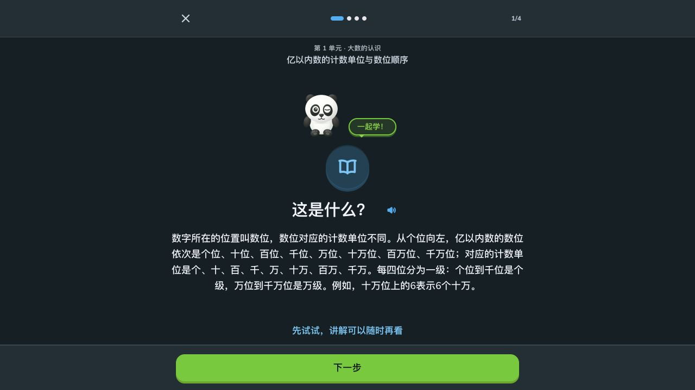

# 剩余三个 issue 逐项复核

按用户要求依次处理 #12 → #7 → #3。当前网站及资源为 [v1.7.3](https://github.com/wuwangzhang1216/congcong-school/releases/tag/v1.7.3)。本轮复核没有改题、改音频或覆盖现有成绩，没有新建重复发布包，也没有恢复已暂停的追踪任务。

## #12：软件修复已上线，等待真人验收

重新读取完整 issue 与全部7条评论，没有新的教师、儿童或真机反馈。此前软件/部署及线上档案保留证据仍有效，见[完整报告](../ux12-2026-10-26/README.md)。UX-02/05/06/07/11/12 继续未勾选，issue 保持开放。

仍需[具体清单](../ux12-2026-10-26/human-checklist.md)中的教师语义/朗读、孩子15分钟、真实设备及弱网、次日/第7天验证。不能因再次运行程序而勾选真人验收；状态应为等待人工验证，而非可交给无监督代理重复实施。

## #7：已在评论区确认具体教材范围

按维护者本轮明确指示，已向原提问者[询问年级、科目、出版社、上/下册及版次](https://github.com/wuwangzhang1216/congcong-school/issues/7#issuecomment-6423803878)，等待回复，保持开放。没有擅自选一个出版社、把五四制只改成标签或宣称已经接入。

[来源清单](five-four-source-inventory.json)固定到 TapXWorld/ChinaTextbook 的 Git commit `e2b3f62213c77bb8c33c5be355f97625ea1b8b61`，API 未截断。小学现有学科对应：

|目录|可直接取得的PDF|边界|
|---|---:|---|
|青岛版五四制数学|10|一至五年级上、下册|
|青岛版五四制科学|20|其中10册主教材，另10册为学生活动手册|
|鲁科版五四制英语|6|三至五年级上、下册|

该来源的五四制小学语文目录只有书法练习指导，不能代替语文主教材。文件存在及 Git SHA 不证明它是当前最新版；具体版次和目录要在范围明确后逐册核对。教育部[国家教学用书目录](https://www.moe.gov.cn/srcsite/A26/s8001/202408/W020240805496325238752.pdf)也区分学制和出版社，不能把不同版本混用。

实施前需处理的现有接入约束：

- 导入清单已有 `school_system: "5-4"` 隔离，但 Web `Book`/`Outline` 尚未完整携带学制和出版社；生成器的学科默认出版社不能直接套在青岛/鲁科教材上。
- 五四制应作为并行教材而非六三制的替代版本；需要独立ID、正确显示学制/出版社，并防止成为现有六三制用户的错误默认教材。
- 六年级在五四制属于初中，现有小学产品不能直接把它显示为小学六年级。初中接入不在尚未确定的小学范围内。
- 具体教材确认后再按其目录补题、生成免费Edge音频、测试、资源发布和旧成绩复验；本轮没有导入任何五四制课程。

## #3：格式兼容改造已完成，重新通过工程与线上验证

原始问题是旧 iPad 浏览器只有提示音，没有讲解人声。修复采用**真实MP3**作为Web运行时格式，旧存档的本地Opus地址优先尝试MP3；iOS原生包继续使用AAC/M4A。这不是把Ogg文件改名或仅改MIME。

Apple [Safari HTML5音频文档](https://developer.apple.com/library/archive/documentation/AudioVideo/Conceptual/Using_HTML5_Audio_Video/Device-SpecificConsiderations/Device-SpecificConsiderations.html)列出iOS支持MP3与AAC；WebKit [Safari18.4发布说明](https://webkit.org/blog/16574/webkit-features-in-safari-18-4/)说明该版才加入Ogg容器的Opus/Vorbis支持。故现有MP3方案解决旧系统的格式支持缺口，无需为网页重复生成全库M4A。

本轮对已发布v1.7.3重新核验：

- 3,351份运行时JSON及实际 `uiAudio()` 返回值，共143,207处引用、122,055个唯一音频；全部为有效MP3，零扩展名/签名/缺失错误。覆盖保留的旧版与新增教材。
- 15个真实编码小样本反例测试通过，包括Ogg改名为MP3必须失败、缺失/损坏文件、权限和缓存一致性；原TTS的优先MP3、一次回退、暂停、源切换和过期事件，以及讲解自然结束/缓冲/自动播放拒绝/超时回归通过。
- 16段实际引用完整本地解码；同16段从CDN实际下载，再核对SHA、`audio/mpeg`、`nosniff`和完整解码，Range均返回206及正确前32字节。含此前报告的核心概念、介绍语、课文、故事。HTTP的iPad样式请求头仅核验服务器交付，不冒称iPad引擎仿真。
- 独立测试档案中手动点击四上中文讲解，自然结束后“下一步”解锁；测试与原档案全部导出字段不变，原档案已恢复。

机器证据：[汇总](audio-verification.json) · [实际CDN音频与SHA](cdn-audio-verification.json)。

结论：格式兼容改造已实现、发布并复验，可按工程修复完成收尾。**尚无iPad6真机验收记录**，不把桌面浏览器、模拟尺寸或HTTP请求头写成真机通过；这项真实设备观察继续在#12清单跟踪。

### 给原提问者的复测步骤

1. 自建站点升级到完整v1.7.3，须同时更新JSON及MP3资源，不能只拉取前端代码。安装入口见[安装说明](../release-install.md)，保持原域名/协议/端口以继续使用原浏览器存档。
2. 重新打开原网址，手动点喇叭或“朗读讲解”，检查设备媒体音量及应用声音设置。无需清除网站数据或存档；没有自动发声与没有手动播放声音分开记录。
3. 可直接试听[核心概念MP3](https://d3nmsqi4n72idj.cloudfront.net/audio/52/52238bfd712374ff6eccc1752fc152b166ef40cc.mp3)，区分文件/网络/系统问题与应用内播放问题。
4. 若仍失败，请在#3补充iPadOS版本、浏览器、具体课时、手动点击后的提示，以及直接试听是否有声；可重新打开继续定位。无需姓名、录音或完整个人存档。

后续：维护者于2026-10-27明确指定先接入上述26册主教材，已完成[逐册版次、目录与正文边界核对](../five-four-2026-10-27/README.md)，不再等待原提问者指定范围。该记录更新不表示已完成发布。
