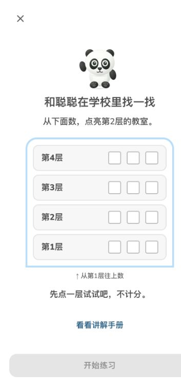

# #12：当前默认首课与人工验收交接

本轮处理当前修订版路径遗漏的互动首课。首次开课直接呈现“从下面数，点亮第2层”的教学楼；选错可重试，选对进入练习，原文字讲解仍可打开。互动不计正式成绩、经验或掌握，不修改教材、题目ID、音频、判题或已完成成绩。

问题根因是原来的点数引导只绑定旧版 `g1up-u1-kp1`；当前默认的 `g1up-2026-u101-kp1` 仍进入三页文字讲解。新增与校园位置主题相符的互动，保留旧版点苹果。旧会话已经开始听讲解时继续原页；新互动选择、练习草稿及已判反馈沿用原保存机制。

## 本轮验证

- 先复现旧默认路径和回归失败，再修复；新增检查进入持续集成，验证实际导出的默认教材、内容变化保护、讲解状态迁移及初始/错误/正确界面。
- 四档手机宽度320/360/390/430px的实际浏览器流程；楼层目标56px、退出48px、讲解入口48px，844px高视口无溢出/按钮覆盖；深浅色及选择后刷新、讲解入口、原题练习分别核验。模拟视口不等于真机或儿童试用。
- Core231、类型、学习质量、外观和10主题回归，以及生产构建。受控网络故障与成绩语义的前轮证据见[2026-10-25报告](../ux12-2026-10-25/README.md)；本轮不冒称重新做了全部网络/音频生成测试。
- 原137课语义指纹逐项匹配当前资源；新增4个优先课合计141个独立课时，仍全部待教师签审。完整题库不是已审核状态。

发布、资源安装、线上旧成绩及原档案保留结果在完成验证后补充至[机器记录](verification.json)。

## 需要配合

[具体清单](human-checklist.md)逐项提供对象、预计时间、页面链接、操作及回传格式。已准备[教师优先队列](teacher-priority.md)、[次日/第7天学生卡](delayed-student-cards.md)和[家长答案与记录表](delayed-parent-key.md)，无需你另行编题。

1. 一年级孩子15分钟：当前默认路径的首次自主学习动作计时，首答/纠错理解、拇指误触和聪聪的作用。
2. 学科教师分批语义及朗读签审，先4个新增重点，再原137课；人工验收卡也需教师审阅。
3. 真实手机及iPad6（若有）的刷新、后台、播放和断网恢复；记录机型、版本、等待时间。
4. 同一孩子次日及第7天新情境验证，记录独立首答、解释和提示情况。

UX-02/05/06/07/11/12 保持未勾选，#12保持开放；30秒为待儿童实测的目标。原定时追踪继续暂停，不需要学生真实姓名或录音。
