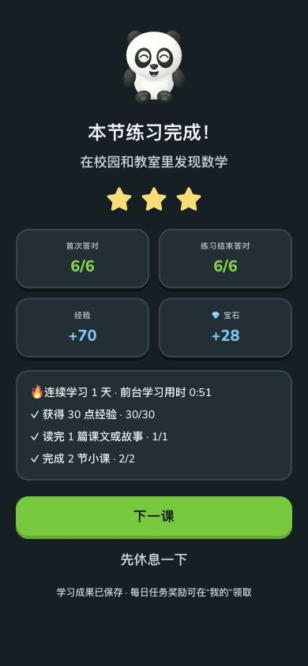

# #12：续学计时修复与剩余验收

本轮修复 Web 课程跨夜续学把离开期间计入结算用时的问题。实际 `LessonRunner` 恢复已检查的最后一题后，只经过5秒，两次均显示1717:42；将旧 `startedAt` 改成当前时间，同一用例变为0:05。根因是结算直接减去开课时间戳，而每日学习时长另用前台计时；并非重复判题或奖励叠加。

两处现统一累计前台时间，使用单调时钟，15秒保存一次检查点；隐藏、离页、BFCache进入和休息弹窗暂停，重新可见才继续。无生命周期通知的系统休眠间隔，单次最多累计30秒，避免把整夜误计。旧草稿只有墙上时间，无法还原先前实际学习时长，因此从本次续学起计；答案、反馈、首答统计、经验及旧成绩均保留。结算标注“前台学习用时”，不把此数字作为专注度或掌握证明。

## 自动验证

- 回归运行真实课程组件的恢复、持久化和结算逻辑，替换显示/媒体与外部存储适配器。覆盖旧草稿、后台24小时、重复隐藏事件、离页与刷新、BFCache恢复、系统时间变化、设置休息、睡眠保护；检查每日时长和结算一致，完成只记账一次，答案/已检查反馈/首答成绩保留。
- Core231项、类型检查、首课交互、草稿/反馈恢复、档案隔离、10套主题深浅色对比度、控件尺寸、学习质量、Service Worker与安装器回归。
- 当前题库35,234个题目判分检查通过；保留基线2,356课15,117题。当前4,448个常规课时均有讲解且至少六题。以上不等同教师语义审题，也不证明迁移或延迟掌握。
- 生产构建7,463页；546,348个教材数据/音频/图片文件与v1.8.0逐字节相同。84个教材版本及旧路由保留。

## 发布方式

v1.8.1只更新Web和源码ZIP。安装清单对未变更附件注明原发布标签，继续校验原大小与SHA-256；按需从原Web及iOS资源页获取，主入口保留导航和安装器。每附件标签仅允许当前仓库内的安全标签名，不支持任意外部下载地址。全新安装与升级仍使用同一清单，不删除原有教材、旧附件或成绩。

[v1.8.1](https://github.com/wuwangzhang1216/congcong-school/releases/tag/v1.8.1)现已正式发布并上线，[PR #54](https://github.com/wuwangzhang1216/congcong-school/pull/54)已合并。源提交 `9776b2e34e71609923030b75b3c2b0a2c9eb273f`；合并提交 `5fe09e3deee430aba9835e4ea1dc6aef2ecb44b4`。两组CI均通过：[Web UX](https://github.com/wuwangzhang1216/congcong-school/actions/runs/40811127979)、[Web experience](https://github.com/wuwangzhang1216/congcong-school/actions/runs/40811127977)。标签与ZIP固定于源提交，最终上线证据作为独立文档补充。

- 完整静态站点561,394文件通过逐文件SHA-256；源码包1,875文件按清单安装并核对源提交，远程安装器实际取回原发布页的50个源数据文件。实际v1.8.0网页升级保留15,047个原网页/自定义文件，新网页15,046文件均通过SHA-256。
- 线上上传14,923个网页与界面文件，保留所有561,758个原S3对象；546,348个教材数据与媒体对象的大小、ETag和LastModified均不变，隐私页不变。所有561,394个当前文件通过S3 MD5；CDN刷新完成，243个页面/JSON/新JS等请求、32个MP3完整SHA/MIME与Range样本通过，覆盖84册及新旧教材代表课程。本轮未重新生成音频。
- 六份既有档案部署前后，全部导出数据字段一致。线上在独立测试档案实做首课6/6、三星、+70XP，刷新后新成绩与全部导出字段一致，原有测试成绩未变。再恢复原档案，其整份导出仍与发布前相等；原教材和语文二下未完成课程入口均保留。原始存档仅存私有本地，不公开。
- 线上计时实测：经历约97秒，设置休息约44秒，结算显示前台51秒（页面进入/加载不计）；确认休息未计入。四档模拟手机宽度320/360/390/430通过，无横向溢出、标题裁切或过小的可用按钮。本地纠错练习分别显示首答5/6与重练6/6，刷新不重复扣心。
- 主发布页7项入口，Web补丁页4项文件，191个未变更ZIP引用v1.8.0原资源页，不增加重复包。新清单、匿名下载和包摘要验证通过；旧1,098个附件的ID、大小、SHA及下载地址保留。仅本次新版本的验证元数据在预发布转正式前更新，ZIP和版本标签不改写。

[完整机器记录](verification.json) · [分类下载导航](https://github.com/wuwangzhang1216/congcong-school/releases/download/v1.8.1/DOWNLOADS.md)

## 仍需人工配合

见[具体操作与反馈格式](human-checklist.md)。UX-02/05/06/07/11/12继续待验收，#12保持开放，原追踪自动化继续暂停。
